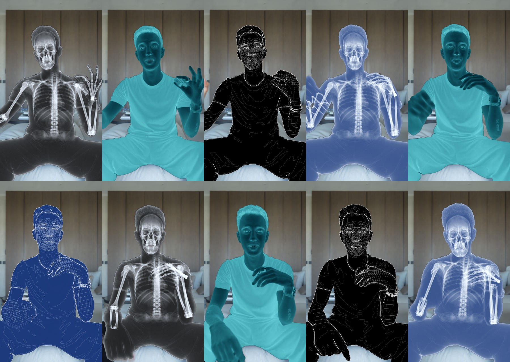

# The X-Ray Effect

The x-ray flicker you keep seeing on Reels, on your own talking head clip. Free, and it runs on your own computer.

## How to use it

1. **Download this repo:** the green **Code** button, then **Download ZIP**, then unzip it.
2. **Open Claude, click the Code button and open this folder.**
3. **Drag in your talking head clip and press Enter.** Say yes when Claude asks to install the free tools.
4. **Drop the finished video into your editing timeline.** It's in the `renders` folder.

Or skip the download and paste this into Claude Code with your clip:

    Clone github.com/corbinsylk/xray-effect, open its CLAUDE.md and put the x-ray effect on this clip.

The first run sets itself up and takes a few minutes. After that it takes about a minute.

## What you need

- Claude Code
- A Mac with Apple Silicon, or a Windows or Linux computer
- A clip of one person, chest up, facing the camera, with their hands visible. It works best in the moments when the hands are fairly still.

There's no API key and no image generator to pay for, and nothing gets uploaded. Your original video isn't changed.

## You can ask Claude to

- "Start it at 12 seconds"
- "Make the colour #E5484D"
- "Less zoom" or "No zoom"

## How it works

The x-ray parts in `parts/` were made once and ship with this repo. On every flash, free tracking software finds your face, body and hands and fits the parts onto them, so the skeleton stays on your pose. The cyan negative and the line drawing are built from your own frame.

The free version has no sound design.

## Credits

Original effect by [@melikazaghari](https://www.instagram.com/melikazaghari/). Built by Corbin Sylk with [MediaPipe](https://github.com/google-ai-edge/mediapipe) (Apache 2.0), OpenCV (Apache 2.0) and FFmpeg via imageio-ffmpeg.

The code is under the MIT licence. Use the parts and the effect in your own videos, commercial ones included.
